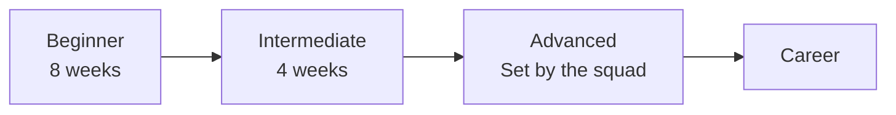

# Backend Squad Roadmap (Laravel)

This roadmap takes you from zero to a job-ready Laravel developer in
three levels: Beginner, Intermediate and Advanced. Every track in the
squad follows the same level structure, so members of different tracks
finish each level at the same time. Anything marked (Optional) can be
skipped without blocking your progress.

| [Start with Beginner](beginner/README.md) | [Intermediate](intermediate/README.md) | [Advanced](advanced/README.md) | [Career](career.md) |
|:-:|:-:|:-:|:-:|

<b>Index</b>

-   [How to use it](#how-to-use-it)
-   [Roadmap at a glance](#roadmap-at-a-glance)
-   [Full map (every page)](#full-map)
-   [Beginner (8 weeks)](beginner/README.md)
-   [Intermediate (4 weeks)](intermediate/README.md)
-   [Advanced](advanced/README.md)
-   [Career](career.md)

## How to use it

-   Go in order, but don't rush. Finish the deliverable of each topic before you move on.
-   Every topic has the Arabic source from the squad plan when one exists, plus two English sources. Pick one and complete it, instead of sampling all of them.
-   Build something at every level. Watching tutorials alone doesn't count as learning.
-   Push everything you build to GitHub from day one.
-   Tick the boxes below as you go.
-   Open the "Resources" dropdown under each topic. Check the Notes column for "Highly recommended" and "Paid" labels.

## Roadmap at a glance

| Level | Duration | What you finish |
|-------|:--------:|-----------------|
| [Beginner](beginner/README.md) | 8 weeks | How the internet works, Git & GitHub, HTTP and APIs, Frontend basics, Language fundamentals, OOP, Advanced language features |
| [Intermediate](intermediate/README.md) | 4 weeks | Database fundamentals, SQL, NoSQL (based on the track), ORM |
| [Advanced](advanced/README.md) | Set by the squad | SOLID, Design patterns, MVC, then advanced topics of your choice (Web API, testing, caching, Docker, deployment, real-time and more) |

## Full map (every page)

-   **[Beginner](beginner/README.md)** · 8 weeks
    -   [Week 1 (part 1) · How the internet works](beginner/01-how-the-internet-works.md)
    -   [Week 1 (part 2) · Git and GitHub](beginner/02-git-and-github.md)
    -   [Week 2 · HTTP and APIs](beginner/03-http-and-apis.md)
    -   [Weeks 3 and 4 · Frontend basics](beginner/04-frontend-basics.md)
    -   [Weeks 5 and 6 · Language fundamentals (PHP)](beginner/05-language-fundamentals-php.md)
    -   [Week 7 · OOP](beginner/06-oop.md)
    -   [Week 8 · Advanced language features](beginner/07-advanced-language-features.md)
-   **[Intermediate](intermediate/README.md)** · 4 weeks
    -   [Week 1 · Database fundamentals](intermediate/01-database-fundamentals.md)
    -   [Week 2 · SQL](intermediate/02-sql.md)
    -   [Week 3 · NoSQL](intermediate/03-nosql.md)
    -   [Week 4 · ORM](intermediate/04-orm.md)
-   **[Advanced](advanced/README.md)**
    -   **Core topics**
        -   [1. SOLID principles](advanced/core/01-solid-principles.md)
        -   [2. Design patterns](advanced/core/02-design-patterns.md)
        -   [3. MVC](advanced/core/03-mvc.md)
    -   **Tier 1**
        -   [1. Web API](advanced/topics/01-web-api.md)
        -   [2. Testing](advanced/topics/02-testing.md)
        -   [3. Security](advanced/topics/03-security.md)
        -   [4. Queues, events and authorization](advanced/topics/04-queues-events-and-authorization.md)
    -   **Tier 2**
        -   [5. Caching with Redis](advanced/topics/05-caching-with-redis.md)
        -   [6. Docker](advanced/topics/06-docker.md)
        -   [7. CI/CD](advanced/topics/07-ci-cd.md)
        -   [8. Deployment](advanced/topics/08-deployment.md)
    -   **Tier 3**
        -   [9. Third-party APIs and payments](advanced/topics/09-third-party-apis-and-payments.md)
        -   [10. Real-time programming](advanced/topics/10-real-time-programming.md)
        -   [11. Admin panel with Filament](advanced/topics/11-admin-panel-with-filament.md)
        -   [12. Livewire, or Inertia with Vue or React](advanced/topics/12-livewire-or-inertia-with-vue-or-react.md)
        -   [13. Packages](advanced/topics/13-packages.md)
        -   [14. Scaling and computer science depth (Optional)](advanced/topics/14-scaling-and-computer-science-depth-optional.md)
-   **[Career](career.md)**
